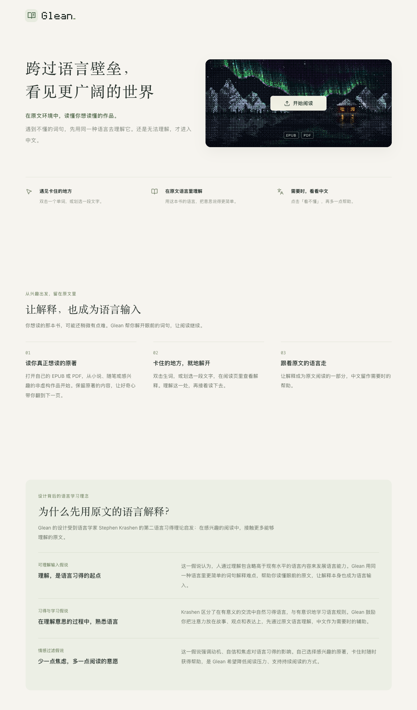
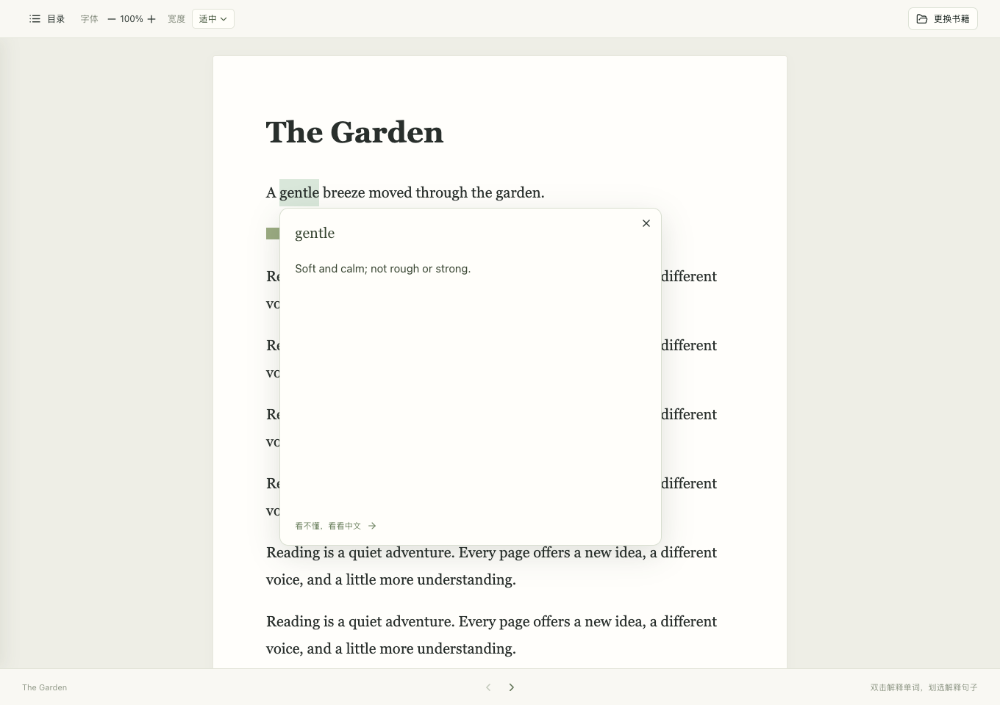

<div align="center">

# Glean.

### 跨过语言壁垒，看见更广阔的世界

在原文环境中，读懂你想读懂的作品。


[](LICENSE)

[开始使用](#快速开始) · [阅读体验](#阅读体验) · [开发与部署](docs/development.md)

</div>



你想读的那本书，可能还稍微有点难。Glean 让你打开自己的 EPUB 或 PDF，遇到不懂的词句，先用同一种语言去理解它。还是无法理解，再进入中文，然后回到原文。

## 阅读体验

**01 · 读你真正想读的作品**

打开自己的书，从小说、随笔或感兴趣的非虚构作品开始。EPUB 支持连续滚动、目录、缩放和阅读宽度调整；PDF 保留原版式，支持文字选择、缩放与页码跳转。

**02 · 让解释也成为语言输入**

双击一个单词，或划选一段文字，即可在阅读页查看流式解释。默认用原文的语言解释，点击「看不懂，看看中文」再获得中文帮助。

**03 · 把注意力留在这一页**

就地选词、查看解释、接着阅读。解释支持取消、超时提示和手动重试，同一次阅读中的解释会缓存在内存里。



<sub>截图使用项目自制示例文本与本地假模型，展示实际界面；真实解释由部署者配置的模型提供。</sub>

## 为什么先用原文的语言解释？

Glean 的设计受到 Stephen Krashen 的第二语言习得理论启发：在感兴趣的阅读中，接触更多能够理解的原文。

| 理念 | 在 Glean 中的设计 |
| --- | --- |
| **可理解输入假说** | 用同一种语言里更简单的词句解释难点，让解释也成为可理解的输入。 |
| **习得与学习假说** | 鼓励关注故事、观点和意义，在阅读中熟悉语言；需要时再借助中文。 |
| **情感过滤假说** | 自己选择有兴趣的作品，遇到困难时获得帮助，减少阅读压力。 |

这些理论是设计启发，不代表产品效果已通过研究验证，也不意味着 Glean 会自动测量或精准匹配你的语言水平。

## 快速开始

需要 **Node.js 22.13+** 和 npm，无需数据库。

```bash
git clone https://github.com/dajiba6/glean.git
cd glean
npm ci
cp config.example.json config.local.json
npm run dev
```

打开 **http://127.0.0.1:3000/glean/**，选择一本 EPUB 或 PDF 即可开始阅读。未配置模型时也可以读书。

要启用解释，在 `config.local.json` 中填写 OpenAI 兼容接口配置，然后重启服务：

```json
{
  "host": "127.0.0.1",
  "port": 3000,
  "llm": {
    "baseUrl": "https://your-provider.example/v1",
    "model": "your-model-id",
    "apiKey": "YOUR_API_KEY",
    "timeoutMs": 60000
  }
}
```

`baseUrl` 不包含 `/chat/completions`。真实配置已被 Git 忽略，密钥仅在服务端读取，不要放入任何 `VITE_` 环境变量。

| 命令 | 用途 |
| --- | --- |
| `npm run dev` | 本地开发，页面和 API 共用一个服务 |
| `npm run build` | TypeScript 检查与生产构建 |
| `npm start` | 启动构建后的生产服务 |
| `npm test` | 服务端测试 |
| `npm run test:e2e` | 浏览器测试，需先构建，默认使用已安装的 Chrome |

安装、环境变量、systemd 启动与重启、反向代理和接口说明见 **[开发与部署指南](docs/development.md)**。本仓库提供部署代码与说明，不代表公共阅读器地址已上线。

## 数据与使用边界

- **书留在浏览器内存中。** 不上传整本书；发送给模型的书籍内容只有选中文字，不附带书名或附近段落。
- **刷新后重新选书。** 不保存书籍、阅读历史或笔记；解释缓存仅保留在当前页面内存中。
- **所有访客共用服务端模型。** 当前无登录、调用频率、并发或额度限制，公开部署时模型费用由部署者承担。
- **优先支持电脑端现代浏览器。** 扫描 PDF 暂无 OCR；加密 PDF、DRM 电子书暂不支持。复杂 PDF 排版可能影响选区顺序，模型的语言覆盖和解释质量取决于所配置的服务。

## 技术与结构

React + TypeScript · Node.js + Express · epub.js · React-PDF / PDF.js

```text
src/                 首页、阅读器、选词与解释界面
server/              服务端配置、模型提示词与流式转发
shared/              SSE 解析
tests/               自制书籍、本地假模型与自动化测试
public/              本地静态资源与阅读房间视觉实验
docs/                项目截图、开发与部署说明
deploy/              systemd 服务模板
```

## 致谢与许可

采用 **[MIT License](LICENSE)**。依赖保留各自的许可证。

- [ascii.rest](https://ascii.rest/aurora-fjord/)：首页动态 ASCII 极光。
- [pixelarticons](https://github.com/halfmage/pixelarticons)：像素图标，许可见 [licenses](licenses/pixelarticons-MIT.txt)。
- [epub.js](https://github.com/futurepress/epub.js)、[React-PDF](https://github.com/wojtekmaj/react-pdf)、[PDF.js](https://github.com/mozilla/pdf.js)：电子书解析与渲染。
- [Cherry Markdown](https://github.com/Tencent/cherry-markdown)：解释内容的 Markdown 渲染。
